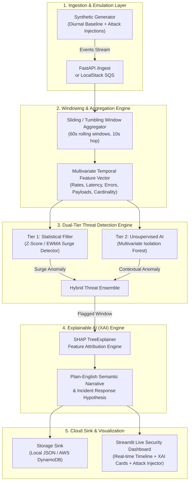

# Temporal Anomaly & Threat Detector for Cloud Workloads

[](#)
[](#)
[](#)

A modular, event-driven temporal anomaly detection pipeline that ingests simulated cloud telemetry, aggregates rolling time windows, and performs dual-tier threat detection coupled with Explainable AI (XAI) feature attributions.

---

## Architecture Overview



---

## 15-Day Production Execution Plan (53 Commits)

| Day | Type | Commits | Key Deliverables |
| :--- | :--- | :---: | :--- |
| **Day 1** | Weekday | 3 | **Phase 1 Initiation:** Project structure, Pydantic log schemas, synthetic generator with diurnal baseline |
| **Day 2** | Weekday | 3 | **Phase 1 Attacks:** Parameterized attack injectors (DDoS, Credential Stuffing, Off-Hour Probing, Exfiltration) |
| **Day 3** | Weekday | 3 | **Phase 2 Windowing:** Sliding/tumbling window aggregator, time bucket slicing, numeric feature extraction |
| **Day 4** | Weekday | 3 | **Phase 2 Statistical Filter:** Real-time Z-score & EWMA stream filter with dynamic threshold calibration |
| **Day 5** | Weekday | 3 | **Phase 2 Unsupervised AI:** Scikit-learn Isolation Forest model training pipeline and baseline persistence |
| **Day 6** | Weekend | 5 | **Phase 3 XAI (Novelty):** SHAP TreeExplainer integration, top-k feature ranking, baseline deviation calculus, automated plain-English hypothesis generator, remediation recommender |
| **Day 7** | Weekend | 5 | **Phase 4 Cloud Abstraction:** In-memory local message queue, AWS Boto3 SQS driver, LocalStack compatibility, DynamoDB/Local JSON storage sink, batch consumer worker |
| **Day 8** | Weekday | 3 | **Phase 5 Backend API:** FastAPI service initialization, `/health`, `/metrics`, `/ingest` streaming endpoints |
| **Day 9** | Weekday | 3 | **Phase 5 API Engine:** `/detect` real-time evaluation endpoint, window query endpoints, background consumer lifecycle |
| **Day 10** | Weekday | 3 | **Phase 6 Interactive Dashboard:** Streamlit app scaffolding, real-time Plotly temporal request rate graphs |
| **Day 11** | Weekday | 3 | **Phase 6 XAI Visualization:** Real-time SHAP waterfall/bar breakdown, threat alert cards, severity badges |
| **Day 12** | Weekday | 3 | **Phase 6 Attack Injector:** Interactive attack injection panel directly triggering synthetic anomalies in dashboard |
| **Day 13** | Weekend | 5 | **Phase 7 Containerization & Hardening:** Dockerfile, Docker Compose (FastAPI + Streamlit + LocalStack), integration tests, edge case stress test, coverage report |
| **Day 14** | Weekend | 5 | **Phase 8 Benchmark & Polish:** Precision/Recall evaluation against injected attack labels, latency benchmarking, presentation slides/walkthrough script, Viva demo scripts |
| **Day 15** | Weekday | 3 | **Final Review 2 / Viva Release:** End-to-end integration verification, documentation sign-off, tagged release `v1.0.0` |

---

## Quickstart (Single-Command Run)

### Windows
```cmd
run_demo.bat
```

### Linux / macOS
```bash
chmod +x run_demo.sh
./run_demo.sh
```

### Direct CLI Verification
```bash
# Generate 100 baseline requests
python -m data.synthetic_generator --count 100 --attack none

# Inject DDoS surge
python -m data.synthetic_generator --count 200 --attack ddos

# Run validation test suite
python -m pytest tests/ -v
```
