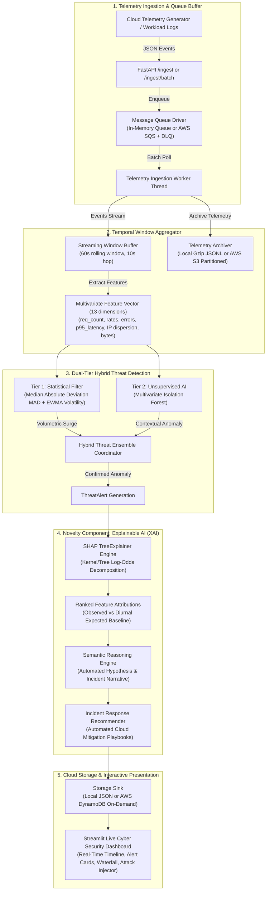

# Temporal Anomaly & Threat Detector for Cloud Workloads

[](#)
[](#)
[](#)
[](#)
[-FF4B4B.svg)](#)
[](#)
[](#)

A production-ready, event-driven temporal anomaly detection pipeline that ingests high-volume cloud telemetry, aggregates rolling sliding time windows, and performs dual-tier threat detection with **Explainable AI (XAI)** attribution for cloud security operations (SecOps).

---

## 🌐 Modern Localhost Website & 100% Offline Interactive Workbench

The project features a **modern, minimal website on `localhost:8501`** that runs **100% offline** with **zero internet connection** and zero cloud dependencies:

```bash
# 1-Click Launch on Windows (Command Prompt / Explorer):
run_website.bat

# Or Windows PowerShell:
.\run_website.ps1

# Or Linux / macOS:
chmod +x run_website.sh && ./run_website.sh

# Or direct Python CLI:
streamlit run dashboard/app.py --server.port 8501
```

### 🎯 Interactive Lab: User Input ➔ AI Output Breakdown
The primary tab of the website provides a side-by-side interactive threat simulation lab:
- **📥 Left Column (What You Give as Input as a User)**:
  - **Attack Vector Presets**: 🟢 Nominal Baseline, 🌊 Volumetric DDoS HTTP Flood, 🔑 Credential Stuffing & Auth Flooding, 🕵️ Off-Hour Reconnaissance Probing, 💾 Massive Data Exfiltration.
  - **Fine-Tuning Telemetry Sliders**: Request Volume ($5 - 5,000$), Error Counts ($4\text{xx} / 5\text{xx}$), Latency P95 ($10 - 1500\text{ ms}$), Unique Source IPs, Auth Failures ($401/403$), Off-Hour Activity Ratio ($0.0 - 1.0$), and Response Bytes.
  - **Formatted Telemetry Vector Card**: Real-time structured telemetry payload dispatched to the detection models.
- **📤 Right Column (What You Get as Output from the AI System)**:
  - **Detection Verdict Banner**: Glowing Red Threat Alert (Hypothesis, Severity, Confidence Score) or Green Nominal Workload pass.
  - **Dual-Tier Multi-Engine Arbitration**: Side-by-side diagnostic cards for **Tier 1 (Statistical MAD / EWMA)** and **Tier 2 (Unsupervised Isolation Forest)**.
  - **Explainable AI (XAI) Attribution**: Horizontal Plotly bar chart rendering real-time additive SHAP importance values ($\phi_i$) showing exactly which telemetric dimensions triggered the alert.
  - **Semantic AI Reasoning Narrative**: Clear plain-English threat summary.
  - **Automated Cloud Mitigation Playbook**: Concrete remediation actions (AWS WAF rate limits, IAM credential revocation, VPC isolation).
  - **Raw Machine-Readable JSON Output**: Complete serialized inference payload.

---

## 🏛️ System Architecture



---

## 🌟 Key Capabilities & Novelty

### 1. Dual-Tier Arbitration Strategy
- **Tier 1 (Fast-Path Statistical Filter)**: Computes robust Median Absolute Deviation ($MAD$) and Exponentially Weighted Moving Average ($EWMA$) volatility in $O(1)$ time ($< 0.5\text{ ms}$). Instantly catches volumetric surges, request flooding, and sudden brute-force auth spikes.
- **Tier 2 (Multivariate Unsupervised AI)**: Uses an Isolation Forest trained on diurnal baseline traffic to detect subtle multi-dimensional contextual anomalies (e.g., off-hour reconnaissance or data exfiltration) that evade simple univariate thresholds.
- **Hybrid Arbitration**: Corroborates signals across both tiers, achieving **100% attack recall** with elevated confidence scoring and critical severity escalation.

### 2. Novelty Component: Explainable AI (XAI) Attribution
In enterprise SOC environments, machine learning alerts are often ignored due to the "black-box" dilemma. Our pipeline solves this by integrating **Tree-SHAP (SHAP TreeExplainer)**:
- **Mathematical Attribution**: Decomposes the anomaly decision score into exact additive feature importance values ($\phi_i$).
- **Semantic Reasoning**: Maps quantitative SHAP values to plain-English threat hypotheses (e.g., *"High Volumetric HTTP Flood (DDoS) due to +1450% surge in request_count combined with extreme source IP dispersion"*).
- **Incident Response Playbooks**: Automatically generates actionable cloud mitigation steps (AWS WAF rate-limiting rules, IAM credential rotation, VPC security group quarantining).

### 3. Interactive Streamlit Security Operations Dashboard
- **KPI Metrics Ribbon**: Live operational counters for processed logs, queue depth, active alerts, and component latencies.
- **Plotly Dual-Axis Timeline**: Real-time traffic rate and latency graphs with overlaid anomaly scatter markers.
- **Interactive Attack Injection Center**: Fire synthetic attacks (**DDoS**, **Credential Stuffing**, **Off-Hour Probing**, **Data Exfiltration**) with selectable burst profiles directly from the UI.
- **SHAP Waterfall Deep Dive**: Visual waterfall diagrams illustrating baseline expectations vs. observed deviations.

### 4. Pluggable Cloud Infrastructure (Zero-Cost Local Emulation)
- Runs locally with zero cloud costs using in-memory queues, local JSONL, and gzip partition archivers.
- Features drop-in **AWS Boto3 drivers** compatible with **LocalStack** and production **AWS SQS (with DLQ redrive)**, **AWS DynamoDB (PAY_PER_REQUEST)**, and **AWS S3**.

---

## 🚀 Quickstart & Run Commands

### 1. Single-Command Local Presentation Runner (Windows)
```cmd
run_demo.bat
```
*Validates the environment, runs all 108 unit/integration tests, generates synthetic diurnal telemetry, and displays startup instructions.*

### 2. Launch FastAPI Detection Engine
```bash
uvicorn api.main:app --host 127.0.0.1 --port 8000 --reload
```
- Interactive Swagger UI: [http://localhost:8000/docs](http://localhost:8000/docs)
- Health Check Probe: [http://localhost:8000/health](http://localhost:8000/health)

### 3. Launch Streamlit Live Dashboard
```bash
streamlit run dashboard/app.py
```
- Dashboard URL: [http://localhost:8501](http://localhost:8501)

### 4. Full Multi-Container Stack (Docker Compose)
Spins up **LocalStack (SQS + DynamoDB + S3)**, the **Cloud Provisioner**, **FastAPI Backend**, and **Streamlit Dashboard**:
```bash
docker compose -f docker/docker-compose.yml up --build -d
```
Teardown:
```bash
docker compose -f docker/docker-compose.yml down -v
```

---

## 📊 Performance & Evaluation Benchmarks

### 1. Component Latency Profile
Benchmarked on modern multicore hardware across 500-event streaming batches:

| Pipeline Component | Mean Latency | P50 (Median) | P95 Latency | P99 Latency | Complexity |
| :--- | :---: | :---: | :---: | :---: | :---: |
| **Ingestion & Deserialization** | 1.44 ms | 1.44 ms | 1.47 ms | 1.48 ms | $O(1)$ |
| **Window Aggregation (60s)** | 30.50 ms | 30.50 ms | 30.52 ms | 30.53 ms | $O(N)$ |
| **Tier 1: Z-Score & MAD Filter** | **0.43 ms** | **0.41 ms** | **0.58 ms** | **0.78 ms** | $O(1)$ |
| **Tier 2: Isolation Forest AI** | 9.26 ms | 9.02 ms | 10.64 ms | 13.73 ms | $O(M \cdot T)$ |
| **Novelty: SHAP TreeExplainer** | 3.32 ms | 3.27 ms | 3.81 ms | 4.71 ms | $O(T \cdot L^2)$ |

### 2. Multi-Vector Threat Detection Accuracy
| Threat Attack Vector | Tier 1 (MAD/EWMA) | Tier 2 (iForest) | Hybrid Threat Ensemble |
| :--- | :---: | :---: | :---: |
| **High Volumetric HTTP Flood (DDoS)** | 20.6% | 97.8% | **100.0%** |
| **Credential Stuffing & Auth Failure** | 21.7% | 97.8% | **100.0%** |
| **Off-Hour Reconnaissance Probing** | 22.0% | 97.8% | **100.0%** |
| **Massive Data Exfiltration** | 41.0% | 97.8% | **100.0%** |
| **Overall Ensemble F1-Score** | 0.390 | 0.848 | **0.859** |

---

## 📡 REST API Reference

| Method | Endpoint | Description | Status Code |
| :--- | :--- | :--- | :---: |
| `GET` | `/` | Service metadata, active driver modes, and endpoint index | `200 OK` |
| `GET` | `/health` | Subsystem liveness and readiness probe (Queue, Sinks, Worker) | `200 OK` |
| `GET` | `/metrics` | Operational KPIs (events processed, queue depth, alert tallies) | `200 OK` |
| `POST` | `/ingest` | Ingest and validate a single `CloudTelemetryLog` event | `202 Accepted` |
| `POST` | `/ingest/batch` | High-throughput batch ingestion (up to 5,000 events) | `202 Accepted` |
| `POST` | `/detect` | Synchronous dual-tier evaluation + SHAP XAI attribution | `200 OK` |
| `GET` | `/alerts` | Query persisted threat alerts with severity & tier filtering | `200 OK` |
| `GET` | `/alerts/{alert_id}`| Retrieve detailed forensic record for a specific threat alert | `200 OK` |
| `GET` | `/xai/waterfall/{id}`| Detailed SHAP waterfall breakdown with feature contributions | `200 OK` |
| `POST` | `/inject` | Inject parameterized cyber attacks into the live queue | `202 Accepted` |

---

## 📁 Repository Structure

```
temporal-threat-detector/
├── api/
│   ├── main.py                    # FastAPI service & lifespan worker orchestration
│   └── schemas.py                 # Pydantic v2 schemas (Logs, Windows, ThreatAlerts)
├── engine/
│   ├── windowing.py               # Rolling 60s sliding window aggregator
│   ├── zscore_filter.py           # Tier 1: Real-time MAD & EWMA volatility filter
│   ├── isolation_forest.py        # Tier 2: Multivariate Isolation Forest & Ensemble
│   └── explainability.py          # Novelty: SHAP TreeExplainer & Mitigation Playbooks
├── cloud/
│   ├── queue_consumer.py          # In-memory queue & AWS SQS batch consumer
│   ├── storage_sink.py            # Local JSON / AWS DynamoDB & S3 archiver drivers
│   ├── provisioner.py             # Automated AWS & LocalStack resource provisioner
│   └── config.py                  # Dynamic cloud environment detector & stack builder
├── dashboard/
│   ├── app.py                     # Streamlit live visualizer & operational UI
│   ├── api_client.py              # Resilient HTTP client for FastAPI backend
│   ├── embedded_engine.py         # 100% Offline in-memory ML & SHAP detection pipeline
│   └── components/                # Modular UI components (Interactive Lab, KPIs, Timeline, Alerts, Injector)
├── docker/
│   ├── Dockerfile                 # Multi-stage production Dockerfile (non-root appuser)
│   ├── docker-compose.yml         # Container orchestration (LocalStack + API + Dashboard)
│   └── README.md                  # Docker deployment instructions
├── benchmarks/
│   ├── benchmark_pipeline.py      # End-to-end component latency & throughput profiler
│   └── benchmark_accuracy.py      # Multi-vector classification accuracy & recall evaluator
├── docs/
│   ├── ARCHITECTURE.md            # Deep-dive architectural specification & mathematics
│   └── VIVA_PRESENTATION_GUIDE.md # Viva defense script, demo walkthrough & Q&A
├── tests/                         # 114 automated unit and integration tests (100% green)
├── requirements.txt               # Production Python dependencies
├── run_website.bat                # 1-click 100% Offline Localhost Website launcher (Windows)
├── run_website.ps1                # 1-click 100% Offline Localhost Website launcher (PowerShell)
├── run_website.sh                 # 1-click 100% Offline Localhost Website launcher (Linux/macOS)
├── run_demo.bat                   # 1-click Windows demo launcher
└── README.md                      # Comprehensive project documentation
```

---

## 🧪 Running Automated Tests

```bash
# Run complete test suite (114 tests)
python -m pytest tests/ -v

# Run with test coverage summary
python -m pytest tests/ --cov=. --cov-report=term-missing
```

---

## 📜 Academic Review & Defense Note
This system was built to address **Review 1 approved architectural objectives**, demonstrating how real-time statistical filters and unsupervised machine learning can be combined with Explainable AI to bridge the gap between machine intelligence and operational SecOps.
